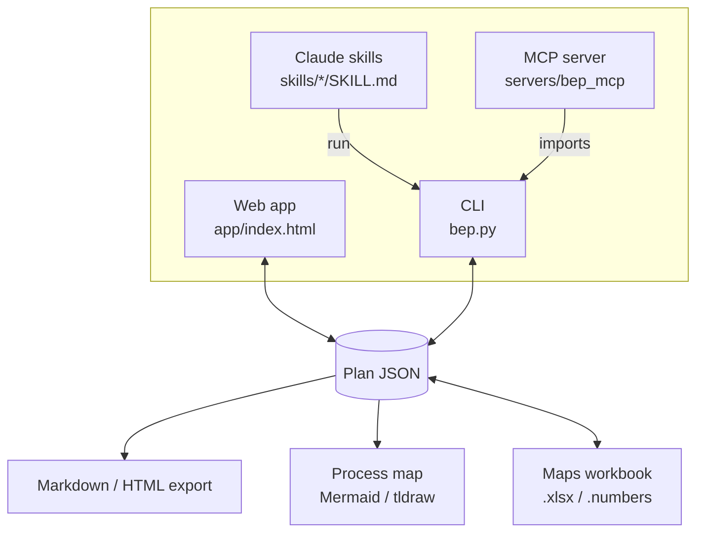

# Architecture: how bep-builder fits together and why

This page explains the design. It has no step-by-step instructions; for those, see [how-to.md](how-to.md). For exact names and fields, see [reference.md](reference.md).

## The problem it solves

A BIM Execution Plan (BEP) is the document a building project team agrees on before modelling starts. It records who models what, which BIM uses the project relies on (clash detection, COBie handover and so on), how models are exchanged, and which CAD and BIM standards apply. US federal projects add agency rules on top, for example USACE drawing conventions.

bep-builder helps a team write that plan in a fixed structure. It has 11 sections following the Penn State / NBIMS-US planning procedure, checks names against the US National CAD Standard (NCS), and produces a finished document.

## Three front ends, one plan

- **The web app** is for people filling in a plan by hand. It walks through the 11 sections like a drawing set: a title block across the top, a sheet index on the left, one sheet open at a time.
- **The CLI** is for scripts, CI and Claude. Every answer lands in a known field, `validate` lists exactly what's missing, and the plan file can be diffed in a repo.
- **The skills** tell Claude when and how to use the CLI and the reference material, for example "check these layer names" or "start a BEP for our barracks project".
- **The MCP server** gives Claude, or any MCP client, the CLI's operations as typed tools instead of shell commands. It imports `bep.py` rather than re-implementing it, so it can't drift from the CLI the way the app could.

All three read and write the same **plan JSON** (fields in [reference.md](reference.md#plan-json)). That shared format is the most important thing to keep stable. A plan exported from the app can be validated with the CLI, and a plan built with the CLI loads in the app. `normalize()` exists on both sides so that plans saved by an older version, which lack newer fields, still load.

## Why the web app is a single file

`app/index.html` contains its HTML, CSS and JavaScript in one file, with no framework and no compile step. It is written as a **Claude artifact page**: a hosted page that is a single file plus the runtime it is given. That is why it starts with `<title>`, `<link>` and `<style>` and has no `<!doctype>` or `<head>`: claude.ai adds that skeleton when it publishes the page.

GitHub Pages serves files as they are, so `tools/build_pages.py` adds the same skeleton for the Pages copy: doctype, `charset`, `lang` and a mobile `viewport`. Without it, browsers would render the page in quirks mode and phones would show it at desktop width. That one small script is the app's only build step, and it runs in the Pages workflow, not on contributors' machines.

A bundler or framework would add a real build and a dependency tree to a page that has neither today. The cost is that the file is long (about 1,300 lines). Section markers inside the `<script>` keep it navigable ([list](reference.md#web-app-script-sections)).

## Why the logic exists twice

The app can't import Python, and the CLI must run without a browser, so the core logic is written once in each language:

- the plan model
- section completion
- the document builder
- the process map
- the ISO 13567 checks
- the NCS name checks

Each JavaScript section names the Python file it was ported from.

Three tests guard the parts where drift would be hardest to spot:
- `test_app_matches_cli` runs the app's script in Node. It compares the process map and the ISO 13567 results with Python's output.
- `test_app_normalize_matches_cli_on_damaged_plans` feeds a damaged plan to both `normalize()` functions and requires the same repair.
- `test_examples_in_sync` requires the three copies of the example plan to be identical.

The rest — completion rules, the document builder and the catalogs — relies on review. That is why every change to shared behaviour is a two-language change ([how-to](how-to.md#change-logic-that-exists-in-both-python-and-javascript)).

## Why some modules are copied between skills

A Claude skill is installed as a self-contained folder, so a skill can't import from another skill. `iso13567.py` therefore ships in both the CLI skill and the NCS skill, and `read_tables.py` ships in both the CLI skill and the Numbers skill. The copies are kept byte-for-byte identical, so "edit one, copy it over" is always the right fix.

## How the app saves

At start-up, `boot()` looks for `window.claude`, the runtime a Claude artifact page is given:

- **As a Claude artifact,** the plan lives in a shared store document named `bep/plan`. About a second after typing stops, the app saves **only the fields that changed**, using the store's `update()`. Nested objects merge, but lists are replaced whole, so an edit inside a team or exchange row saves that one list. Two people editing different fields therefore don't overwrite each other. Loading the example, clearing the plan or creating a new store document writes the whole plan with `set()` instead. `onSnapshot` brings teammates' changes in live, with any edits this browser hasn't saved yet laid back on top (`overlayEdits`). If someone else saves while you're typing, the app shows a "Load their changes" banner instead of overwriting your input. Viewers without write access get a read-only page. If the shared store drops out, the app switches to saving in the browser.
- **Anywhere else** (GitHub Pages, a local server), the plan is saved to the browser's `localStorage` under `bep-builder-plan`. A banner explains that the plan is saved in this browser only and should be exported to keep a copy, and links to the team's shared copy (the artifact at `HELP.shared` in the app's reference data).

So the same file serves both cases with no configuration. It does mean that on GitHub Pages the data never leaves the user's browser.

## The process map model

Section 05 needs a Level 1 process map: which BIM uses happen in which phase, and which information exchanges connect them. `processmap.build()` produces one layout:

- phases as columns (Planning, Design, Construction, Operations)
- one box per selected BIM use
- arrows between phases

Each exchange from section 06 labels the arrow into the BIM use it feeds. That use comes from the exchange's `feeds` field if set, otherwise from keyword matching (`USE_KEYWORDS` in Python, `USE_WORDS` in the app). An exchange that matches nothing is listed in a note rather than silently dropped. The one layout is then rendered as Mermaid (for exports, GitHub and the app) or as a tldraw script (an editable canvas).

The **maps workbook** is the editable side of this model. `maps-workbook` writes the uses and exchanges of one or more plans to `.xlsx`. People edit it in Excel or Apple Numbers, and `apply-maps` reads it back and reports each change. Applying an unchanged workbook is a no-op, and applying the same edits twice gives the same result; the tests check both.

## The MCP server

The server (`servers/bep_mcp/`, design in [docs/design/mcp-server.md](../design/mcp-server.md)) runs on the user's machine over stdio. It is a thin layer over `bep.py`:

- **No rules of its own.** Every CLI command that changes or checks a plan calls a plain function in `bep.py` that returns data and raises `ValueError`. The CLI prints the result or exits with the message; the server returns it as JSON or as an error the model can read and correct. A rule changed in `bep.py` changes both.
- **One folder of plans.** Tools take a plan's file name, never a path. `resolve_plan` rejects names with folders and anything that resolves outside `BEP_PLANS_DIR`, symlinks included.
- **One write at a time.** The SDK runs tool calls on threads, so every load → change → save holds one lock. Without it, two quick edits to the same plan could each load the old file and one would be lost.
- **Hints for the client.** Each tool says whether it is read-only or destructive (`bep_remove_row`, `bep_save_document`, `bep_create_plan` with `overwrite`), so a client can ask before running the risky ones.

It needs Python 3.10 and the `mcp` package, unlike the CLI, which is why it lives in `servers/` rather than inside a skill. The folder is not called `mcp/`, because that name would hide the SDK's own `mcp` package on import.

## Firm defaults

New plans start with the firm's defaults:

- ISO 13567 layer naming off
- the `element` layer format
- status letters in the status field
- `SHET` as the sheet-level annotation code

ISO 13567 bans `ANNO`, and `SHET` takes its place for sheet-level annotation such as title blocks. The CLI and the app must agree on these defaults, and `test_cli_plan_lifecycle` checks the CLI side.

## Licensing

The NCS is a licensed standard. The rules in this code were checked against a licensed copy, but the repository holds **no NCS text**: reference summaries made from a licensed copy are kept out. That is why `check_names.py` mentions `references/conventions.md`, a file that is not in the repo. Don't add it, and don't paste standard text into docs, code comments or evals. ISO 9001 and ISO 13567 are cited by clause number only. `.gitignore` excludes `*.pdf`, `*.numbers` and `plans/` so project data and purchased standards aren't committed by accident.

## Deployment

The only deployed piece is the web app. Whenever `app/` or `tools/build_pages.py` changes on `master`, `pages.yml` wraps the page with `tools/build_pages.py`, writes it to `_site/`, and publishes that folder to GitHub Pages. There must be only one Pages workflow: an earlier second workflow published the whole repository to the same site and replaced the app with the README.

## Where it runs

CI runs both test suites on both Ubuntu and Windows, so the Python code sticks to portable paths and the standard library. A dev container (`.devcontainer/`) gives Codespaces users the same Python 3.12 + Node 20 setup as CI, and `copilot-setup-steps.yml` gives GitHub Copilot's coding agent the same.
